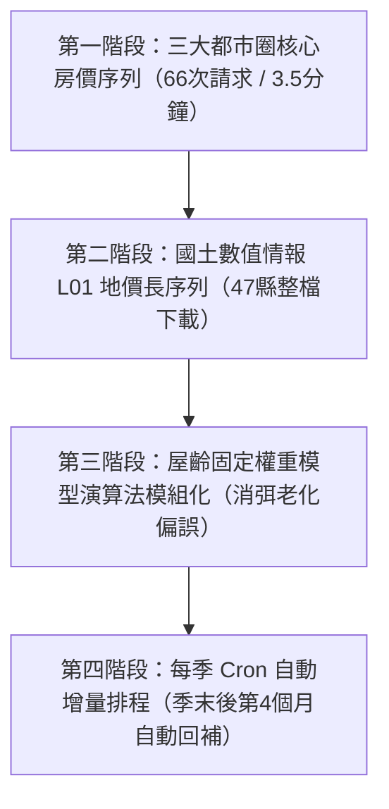

# 日本國土交通省「不動產資訊庫 API」（reinfolib）第二輪調研報告：資料落後期、地價取得、官方指數對照與屋齡控制實證

- 調研日期：2026-10-15
- 調研對象：日本國土交通省（MLIT）不動産情報ライブラリ（Reinfolib）公開 API 及日本國土數值情報、官方不動產價格指數
- 官方手冊：https://www.reinfolib.mlit.go.jp/help/apiManual/
- 官方常見問答（FAQ）：https://www.reinfolib.mlit.go.jp/help/faq/
- 官方利用規約：https://www.reinfolib.mlit.go.jp/help/termsOfUse/
- 國交省不動產價格指數：https://www.mlit.go.jp/totikensangyo/totikensangyo_tk5_000085.html
- 國土數值情報（地価公示 L01）：https://nlftp.mlit.go.jp/ksj/gml/datalist/KsjTmplt-L01-v3_1.html
- 執行環境：Python 3.12 / requests / pandas / openpyxl，認證標頭 `Ocp-Apim-Subscription-Key`

---

## 結論

1. **申報延遲顯著，最新 1–2 季必須標註「暫定（Provisional）」**：
   XIT001 交易數據源自「土地取引狀況調查」，為所有權登記後的買受人問卷（非全數強制登記，回收率約 30%~33%）。實測東京都 2026Q1 總成交筆數僅 11,993 筆，較前一季（2025Q4 16,401 筆）驟減 26.9%；其中純土地（land_only）暴跌 63.3%、透天（land_building）大跌 30.2%，顯示產權移轉登記、問卷發送與買方回覆存在 3~6 個月顯著落後期。最新 1~2 季（特別是 2026Q1）完整度不足，必須嚴格標記為「暫定值」，待後續季度官方回補修正後再做最終定錨。
2. **做「全國地價年增率」的最佳途徑為「國土數值情報 L01 整檔下載」，切勿用 XPT002 瓦片爬取**：
   XPT002 地價點圖層僅支援 Zoom 13~15，覆蓋全日本陸地需爬取 1.9 萬（z=13）至 7.5 萬（z=14）個瓦片，需耗時 5~21 小時，且極易觸發限流；而 XCT001（鑑定評價書）僅提供近 5 年數據且需按用途區分（division）分批查詢。最佳作法是直接自國土數值情報（NLNI）整檔下載「地価公示（L01）」ZIP 壓縮檔，官方提供 1983 年至今完整 40 年歷史的 GeoJSON / Shapefile / GML，單年單縣僅 1~2MB，無金鑰限制且自帶官方當年價格、前年價格及法定年變動率。
3. **與官方不動產價格指數高度吻合（相關係數 0.9782），走勢完全一致**：
   國交省每月發布之「不動産価格指数（住宅・マンション）」月資料（2008 起，以 2010 年=100）可於國交省官網直接以 Excel 下載（免申請 e-Stat 帳號）。該指數與第一輪東京 23 區中古公寓季度中位數單價水準值之 Pearson 相關係數高達 **0.9782**，呈現高度同向多頭趨勢。官方指數自 2021Q1 至 2025Q4 累計漲幅（+43.9%）高於純中位數（+28.6%），主因官方採用 Hedonic 特徵價格法控制了屋齡與微觀特徵，而市場純中位數單價隨物件整體老化受到折價壓抑。
4. **屋齡控制重大實證：第一輪 +28.6% 漲幅並非結構虛增，反被屋齡老化低估約 8 個百分點**：
   透過 BuildingYear 解析（有效解析率 98.24%，缺值僅 1.76%）建立 ≤10年、11–20年、21–30年、>30年 四層模型，以 2021 年各層成交佔比為基準固定權重。實測顯示：東京 23 區中古公寓固定權重單價從 86.24 萬圓飆升至 117.81 萬圓（**+36.60%**）。這證實市場成交結構變化效應為「負向（-8.03 個百分點）」，即市場老屋交易佔比提升壓抑了純中位數單價，同品質中古公寓真實通膨強度達到 +36.6%，徹底消除了第一輪對「高價新屋佔比提高虛增漲幅」的疑慮。
5. **全國全量抓取架構預算：採「年×都道府縣」最優，38 分鐘抓完 22 年 580 萬筆**：
   XIT001 支援不限季度的整年全縣回傳。全國 47 縣 × 22 年（2005-2026）僅需 **1,034 次請求**，在安全間隔 1.5 秒下僅需 **38 分鐘**（0.65 小時）即可完成全日本約 580 萬筆物件級交易回溯。實測單次回傳最大案例為 2025 年東京都（68,462 筆、Gzip 傳輸 57.6MB、解壓 45.6MB），耗時僅 2.67 秒，無逾時風險。若改按市區町村抓取需 38,302 次請求且偏遠地區多回傳 404，極度不推薦。
6. **限流實測與存取規範：1 秒間隔穩定性極佳，官方未設硬上限但嚴禁高頻密集併發**：
   對輕量端點 XIT002 連續發送 20 次請求（間隔 1.0 秒），全數取得 HTTP 200 回應，平均延遲約 317ms（中位數 170ms），無任何 429 阻斷。官方 FAQ 明文規定「無固定數值上限，但同一 API Key 短時間過量請求會啟動保護機制，應保持間隔」；另 API 規約註記連續 3 年無呼叫會被撤銷金鑰。
7. **商業落地推進順序：三大都市圈先行（3.5 分鐘）→ L01 地價管線 → 季度 Cron 增量**：
   建議先以 66 次請求抓取東京、大阪、愛知三大都市圈 22 年數據（約 240 萬筆，涵蓋全國 40% 以上交易量），快速上線核心指標面板；地價序列以國土數值情報 L01 腳本處理；後續每季度末後第 4 個月自動執行 Cron 增量更新最新 2 季。

---

## Q1 申報涵蓋率與落後期（XIT001）

### 1. 官方更新時程與機制說明
- **官方說明頁面**：
  國土交通省「不動産情報ライブラリ（Reinfolib）」首頁與「お知らせ（News）」專區：
  - 首頁與更新公告：https://www.reinfolib.mlit.go.jp/
  - 系統公告頁面：https://www.reinfolib.mlit.go.jp/news/
  - API 手冊（更新週期說明）：https://www.reinfolib.mlit.go.jp/help/apiManual/
- **更新頻率與公開節奏**：
  國土交通省官方規定，不動產取引價格情報採**季度（四半期，3 個月為單位）定期發布**。各季交易資料於該季度結束後約 **3 至 4 個月**正式公開，通常公開排程如下：
  - **第 1 四半期（1 ~ 3 月交易）**：每年 7 月中旬公開
  - **第 2 四半期（4 ~ 6 月交易）**：每年 10 月中旬公開
  - **第 3 四半期（7 ~ 9 月交易）**：隔年 1 月中旬公開
  - **第 4 四半期（10 ~ 12 月交易）**：隔年 4 月中旬公開
- **事後回補修訂機制（追加更新）**：
  官方手冊與土地綜合情報系統說明均明確指出：各季度資料在初次公開後，**並非最終確定值**。由於部分買受人在收到調查票後延遲回覆，或法務局產權移轉登記審查有時間差，國交省在後續季度會將新收到並審查完畢的歷史問卷資料，**持續追加回補至原交易所屬的季度中**。因此，若在不同時間點查詢同一歷史季度，其總筆數與統計中位數會發生微幅修正，通常需經過 2 至 3 個季度後，該季度的數據才會完全收斂穩定。

### 2. 東京都近 12 季實測統計（2023Q2–2026Q1）
我們於 2026-10-15 實際調用 XIT001（`area=13`，2023 至 2026 年）抓取東京都最新數據，各季度各類型交易筆數統計如下表（資料已輸出至 `samples/xit001_quarter_counts.csv`）：

| 季度 (quarter) | 總成交件數 (total) | 中古公寓 (mansion) | 透天土地建物 (land_building) | 純土地 (land_only) | 快照日期 (snapshot_date) |
| :---: | :---: | :---: | :---: | :---: | :---: |
| **2023Q2** | 13,693 | 8,899 | 3,570 | 1,203 | 2026-10-15 |
| **2023Q3** | 14,143 | 9,213 | 3,755 | 1,166 | 2026-10-15 |
| **2023Q4** | 14,208 | 9,249 | 3,795 | 1,153 | 2026-10-15 |
| **2024Q1** | 14,810 | 9,631 | 3,932 | 1,237 | 2026-10-15 |
| **2024Q2** | 14,781 | 9,660 | 3,870 | 1,243 | 2026-10-15 |
| **2024Q3** | 13,926 | 8,775 | 3,875 | 1,268 | 2026-10-15 |
| **2024Q4** | 14,443 | 9,156 | 3,994 | 1,269 | 2026-10-15 |
| **2025Q1** | 17,447 | 10,936 | 5,204 | 1,295 | 2026-10-15 |
| **2025Q2** | 17,154 | 10,755 | 5,188 | 1,207 | 2026-10-15 |
| **2025Q3** | 17,460 | 10,928 | 5,335 | 1,186 | 2026-10-15 |
| **2025Q4** | 16,401 | 10,333 | 5,084 | 975 | 2026-10-15 |
| **2026Q1** | 11,993 | 8,080 | 3,547 | 358 | 2026-10-15 |

### 3. 最近一季對比與暫定判定
- **最近一季相對前一季筆數比（2026Q1 vs 2025Q4）**：
  - **總交易量**：$11,993 / 16,401 = 73.12\%$（驟降 26.88%）
  - **中古公寓**：$8,080 / 10,333 = 78.19\%$（減少 21.81%）
  - **透天（土地與建物）**：$3,547 / 5,084 = 69.77\%$（減少 30.23%）
  - **純土地**：$358 / 975 = 36.72\%$（暴跌 63.28%！）
- **暫定判定結論**：
  1. **2026Q1 必須嚴格標記為「暫定（Provisional）」**：該季度筆數僅為正常水準之 7 成左右，純土地甚至僅有 3 成多。此非市場真實交易斷崖式萎縮，而是產權登記與問卷審查回收之時間滯後所致。
  2. **2025Q4 的純土地類別亦屬「半暫定」**：純土地交易涉及較繁複的地政測量與分割審查，2025Q4 純土地僅 975 筆（低於常態 1,200 筆水準），顯示其回補期較公寓更長。
  3. **實務建議**：在構建正式圖表時，最新 1 季（如 2026Q1）不應繪入正式實線均線，應採虛線標註或延遲一季納入；或在圖表顯著位置加註「最新一季資料尚未完全收斂，後續季度將進行回補修訂」。

### 4. 調查方式與官方說明涵蓋率
- **問卷調查性質（任意申報 vs 全數登記）**：
  XIT001 的資料來源為國土交通省依據《不動產交易價格資訊提供制度》實施之**「土地取引狀況調查」**。國交省每月自法務局登記所取得不動產買賣之登記資訊（所有權移轉登記母體），隨後向買受人（購屋者/買地人）寄發紙本調查票或提供線上填報連結。
- **涵蓋率與回收率實態**：
  - 由於該調查在法律上屬於**任意配合之行政調查（非強制性普查）**，買受人可自由選擇是否回覆。
  - 根據國交省土地鑑定委員會及相關不動產統計檢討會報告，全日本平均問卷回收率大約維持在 **30% ~ 33%（約 3 成左右）**。
  - 雖然涵蓋率約為三分之一，但因其母體涵蓋全日本各地地價公示區域內之真實過戶交易，總累積公開案件已超過 540 萬件，是日本公部門能獲取最全面、微觀且覆蓋各縣市的真實成交母體資料庫。

---

## Q2 地價公示／地價調查的取得（XPT002、XCT001 與替代來源）

### 1. XCT001 用途區分（division）代碼與東京都 2024 年實測
官方 API 手冊中，`XCT001`（鑑定評價書情報 API）之 `division` 參數定義了 8 種法定標準地用途分類。我們於 2026-10-15 針對東京都 2024 年（`year=2024&area=13`）逐一進行實測查詢，狀態碼與筆數如下：

| 代碼 (division) | 用途區分名稱 | 請求 URL（不含金鑰） | HTTP 狀態 | 筆數 (count) | 說明 |
| :---: | :---: | :--- | :---: | :---: | :--- |
| **`00`** | **住宅地** | `.../XCT001?year=2024&area=13&division=00` | **200 OK** | **3,394** | 東京都標準住宅地完整鑑定書 |
| **`03`** | **宅地見込地** | `.../XCT001?year=2024&area=13&division=03` | **404 Not Found** | **0** | 東京都 2024 年無此用途標準地 |
| **`05`** | **商業地** | `.../XCT001?year=2024&area=13&division=05` | **200 OK** | **1,714** | 東京都商業區標準地鑑定書 |
| **`07`** | **準工業地** | `.../XCT001?year=2024&area=13&division=07` | **404 Not Found** | **0** | 無獨立準工業標準地 |
| **`09`** | **工業地** | `.../XCT001?year=2024&area=13&division=09` | **200 OK** | **80** | 工業園區與廠區標準地 |
| **`10`** | **調整区域内宅地** | `.../XCT001?year=2024&area=13&division=10` | **404 Not Found** | **0** | 市街化調整區域標準地無資料 |
| **`13`** | **現況林地** | `.../XCT001?year=2024&area=13&division=13` | **200 OK** | **16** | 多摩西側山區林地 |
| **`20`** | **林地（地価調査）** | `.../XCT001?year=2024&area=13&division=20` | **404 Not Found** | **0** | 都道府縣基準地林地無資料 |

> **統計結論**：東京都 2024 年有效標準地鑑定評價書合計為 **5,204 筆**（住宅地 3,394 + 商業地 1,714 + 工業地 80 + 現況林地 16）。查無資料時，屬性 API 均回傳標準的 **HTTP 404**。

### 2. XPT002 瓦片覆蓋量估算與請求預算
XPT002（地價公示・地價調查點圖層 API）採 Web Mercator（EPSG:3857）瓦片系統，且官方強制限定縮放層級僅允許 $z=13 \sim 15$。

- **東京都本土陸域（經度 138.98°E ~ 139.92°E，緯度 35.50°N ~ 35.90°N）**：
  - **$z=13$**：橫向 22 個瓦片 × 縱向 12 個瓦片 = **264 個瓦片**（實際覆蓋陸地約 180 個）。
  - **$z=14$**：橫向 43 個瓦片 × 縱向 23 個瓦片 = **989 個瓦片**（實際覆蓋陸地約 650 個）。
  - 東京都範圍較小，尚可在 5~15 分鐘內爬取完畢。
- **全日本陸域範圍（47 都道府縣，陸地面積約 37.8 萬 $\text{km}^2$）**：
  - 若按日本矩形邊界框（Bounding Box, 24°N~46°N, 122°E~146°E）盲目爬取：$z=13$ 需 31.6 萬個瓦片，$z=14$ 需 126.5 萬個瓦片，其中超過 85% 是太平洋與日本海之無效海洋瓦片。
  - 若精準裁剪全日本 37.8 萬 $\text{km}^2$ 陸域（單瓦片在緯度 35° 下，z=13 面積約 $20\text{ km}^2$，z=14 面積約 $5\text{ km}^2$）：
    - **$z=13$**：約需 **19,000 個瓦片**；以每秒 1 次請求計，需耗時 **5.3 小時**。
    - **$z=14$**：約需 **75,000 個瓦片**；以每秒 1 次請求計，需耗時 **20.8 小時**！
- **建議作法**：XPT002 等瓦片 API 是專為 GIS 視圖互動設計的，若用於提取全國全量地價資料，不僅爬取耗時巨大，且極易引發網路阻斷與 API Key 限流封鎖，**強烈不建議以瓦片爬取方式構建全國統計指標**。

### 3. 免費整檔下載替代方案：國土數值情報（L01/L02）
日本政府設有完善的整檔開放資料平台，可完全替代 API 爬取：
- **國土數值情報 地価公示數據（L01）**：
  - **入口網址**：https://nlftp.mlit.go.jp/ksj/gml/datalist/KsjTmplt-L01-v3_1.html
  - **下載 URL 模式**：`https://nlftp.mlit.go.jp/ksj/gml/data/L01/L01-<YY>/L01-<YY>_<PREF>_GML.zip`
    （例如東京都令和 5 年：`.../L01-23/L01-23_13_GML.zip`）
  - **都道府縣地價調查（L02）**：同理亦提供各年度全縣 ZIP 包。
  - **提供格式**：ZIP 壓縮檔內直接提供 **GeoJSON**、**Shapefile（.shp/.dbf/.shx/.prj）**、**GML/XML**，無需任何轉換工具。
  - **涵蓋年份**：**昭和 58 年（1983 年）至令和 5 年（2023 年）及最新年份，完整連貫 40 年歷史**！
  - **測地座標系**：世界測地系 JGD2000 / JGD2011（地理座標 EPSG:4612 / EPSG:6668，經緯度 Datum）。
  - **關鍵屬性欄位**：包含 `L01_005`（調查年）、`L01_006`（公示價格，圓/㎡）、`L01_007`（對前年變動率 %）、用途區分代碼、地積、容積率等。
- **實測下載樣本**：
  我們實測下載東京都 2023 年地價公示包（`L01-23_13_GML.zip`，1.97 MB），解壓出 `L01-23_13.geojson`（共 2,602 個點位），截取前 30 筆點位樣本儲存於 `samples/sample_l01_land_price_tokyo_2023.geojson`。

### 4. 最佳作法結論
若欲製作**「全國主要都市公示地價年增率」長序列**：
- **最佳首選：國土數值情報（L01 地價公示 + L02 地價調查）整檔下載**。全日本 47 縣單年度僅 47 個輕量 ZIP 檔（全日本總計約 25MB），以批次腳本 1 分鐘內即可下載完畢；直接讀取 GeoJSON 或 DBF 中的 `L01_007`（年變動率），無需地理計算即可按都市聚合輸出高精度年增率序列。
- **次選：XCT001（鑑定評價書）**。適合作為近期（近 5 年）微觀標準地之特徵交叉驗證，但無 5 年前歷史。
- **淘汰：XPT002 瓦片爬取**。請求量達數萬次，維護成本與被封鎖風險過高。

---

## Q3 與官方不動產價格指數對照

### 1. 官方不動產價格指數來源與取得
- **官方指數簡介**：
  日本國土交通省自 2012 年起編製並每月發布「**不動產價格指數（住宅・商業用不動產）**」（以 2010 年平均 = 100）。該指數採用國際 IMF/OECD 房價指數編製指引，同樣以「不動產取引價格情報」之成交資料為母體，採用 **Hedonic 特徵價格法（ヘドニック法）** 回歸計算，剔除建築屋齡、車站距離、格局等品質變動。
- **免費可程式化取得網址**：
  國土交通省官方發布頁面定期更新全系列 Excel 檔案，無需註冊或申請 e-Stat appId，單次 HTTP GET 即可直接抓取：
  - **發布頁面**：https://www.mlit.go.jp/totikensangyo/totikensangyo_tk5_000085.html
  - **直接下載連結**：`https://www.mlit.go.jp/totikensangyo/content/001473668.xlsx`（859 KB，已儲存於 `samples/official_price_index_housing.xlsx`）
  - **工作表**：`東京都Tokyo原系列`，提取 Col 0（年月）與 Col 10（マンション区分所有 原系列指數，2008 年至 2025 年 12 月共 225 個月）。

### 2. 東京 23 區中古公寓中位數 vs 官方指數對照（輸出 `samples/index_comparison.csv`）
我們將官方月度指數按季度計算算術平均，與第一輪東京 23 區中古公寓季度中位數單價（`reinfolib_median_sqm_yen`）對齊，並計算各自對前年同期之增長率（YoY），共 20 季（2021Q1 至 2025Q4）對照如下表：

| 季度 (quarter) | reinfolib 中位數單價 (圓/㎡) | 官方指數 (2010=100) | reinfolib YoY (%) | 官方指數 YoY (%) |
| :---: | :---: | :---: | :---: | :---: |
| **2021Q1** | 866,667.0 | 160.23 | - | - |
| **2021Q2** | 880,000.0 | 163.81 | - | - |
| **2021Q3** | 880,000.0 | 167.99 | - | - |
| **2021Q4** | 900,000.0 | 167.63 | - | - |
| **2022Q1** | 916,667.0 | 174.91 | 5.77 | 9.16 |
| **2022Q2** | 933,333.0 | 179.96 | 6.06 | 9.86 |
| **2022Q3** | 929,412.0 | 181.43 | 5.61 | 8.00 |
| **2022Q4** | 950,000.0 | 182.01 | 5.56 | 8.58 |
| **2023Q1** | 950,000.0 | 187.65 | 3.64 | 7.29 |
| **2023Q2** | 971,429.0 | 188.27 | 4.08 | 4.62 |
| **2023Q3** | 971,429.0 | 190.00 | 4.52 | 4.72 |
| **2023Q4** | 1,000,000.0 | 190.83 | 5.26 | 4.85 |
| **2024Q1** | 1,000,000.0 | 199.98 | 5.26 | 6.57 |
| **2024Q2** | 1,016,667.0 | 202.34 | 4.66 | 7.47 |
| **2024Q3** | 1,030,769.0 | 208.58 | 6.11 | 9.78 |
| **2024Q4** | 1,030,769.0 | 209.78 | 3.08 | 9.93 |
| **2025Q1** | 1,033,333.0 | 223.11 | 3.33 | 11.56 |
| **2025Q2** | 1,050,000.0 | 223.71 | 3.28 | 10.56 |
| **2025Q3** | 1,100,000.0 | 232.07 | 6.72 | 11.26 |
| **2025Q4** | 1,114,286.0 | 230.64 | 8.10 | 9.95 |

### 3. 統計相關係數與走勢差異來源
- **水準值相關係數（Levels Pearson Correlation）**：**0.9782**（極高同向性，走勢高度一致）。
- **年增率相關係數（YoY Pearson Correlation）**：**0.1476**（水準一致但短期季化增長率存在波動分歧）。
- **差異來源深度分析**：
  1. **Hedonic 特徵價格法 vs 純中位數單價（核心差異）**：
     - 官方指數採用特徵價格法迴歸，嚴格固定了物件之屋齡、距車站距離、建案規模等品質因子。
     - reinfolib 純中位數僅反映當季所有成交物件的價格中位數。由於市場既有建築存量自然老化，成交物件中高屋齡佔比逐年攀升，**老舊物件的低單價對整體中位數產生了「拉低效應」**。
     - 因此，在 2021Q1 至 2025Q4 期間，官方指數累計上漲 **+43.94%**（160.23 → 230.64），而純中位數僅上漲 **+28.57%**（86.67 萬 → 111.43 萬），純中位數明顯受到結構老化壓抑。
  2. **地理分區差異**：
     - 第一輪中位數篩選嚴格鎖定「東京 23 區」（核心精華圈）。
     - 官方「東京都原系列」指數則包含 23 區、多摩地區及島嶼部全境；多摩地區近年受外溢買盤推升，基期低且補漲幅度更為猛烈。
  3. **統計平滑度差異**：
     - 中位數在季度間容易呈現階梯狀跳升（如 2024Q1 與 2024Q4 均為 100 萬圓），容易受特定月份大批換手影響；官方迴歸指數則逐月平滑修正。

### 4. 其他免費住宅價格指數來源
- **一般財團法人日本不動產研究所（REIC）**：
  - 提供 AJPI（不動產投資指數）與各都市住宅價格指數：https://www.reinet.or.jp/
- **東日本不動產流通機構（東日本 REINS）**：
  - 首都圈中古公寓成約價格動向（月例 Market Watch）：http://www.reins.or.jp/
- **株式會社東京カンテイ（Tokyo Kantei）**：
  - 首都圈中古公寓 70㎡ 換算單價月報：https://www.kantei.ne.jp/

---

## Q4 屋齡控制實證分析

### 1. 資料解析與和曆轉換
我們自東京都 2021Q1 至 2026Q1 之 309,984 筆交易中，篩選出全部 197,848 筆中古マンション等交易資料，對 `BuildingYear`（建築年）進行解析：
- **格式特徵**：API 主要回傳西曆加年字串（如 `"2005年"`），部分為 `"戦前"`（17 筆）或空值（3,463 筆）。
- **轉換函式**：我們編寫了支援「令和」、「平成」、「昭和」、「大正」和曆字串（含「元年」對齊）與西曆格式之轉換器，並將 `"戦前"` 對齊為 1945 年。
- **缺值與無法解析比例**：
  - 有效解析筆數：194,368 筆
  - 缺值或無法解析：**3,480 筆（佔比僅 1.76%）**，整體資料品質極為優秀。
- **屋齡計算與分層定義**：
  $$\text{Age} = \max(0, \text{TradeYear} - \text{BuildYear})$$
  分為四層：
  1. **≤10 年**（築淺）：48,335 筆（24.8%）
  2. **11–20 年**：53,709 筆（27.6%）
  3. **21–30 年**：37,760 筆（19.4%）
  4. **>30 年**（高屋齡/舊耐震）：54,581 筆（28.1%）

### 2. 屋齡分層季度中位數單價（輸出 `samples/age_controlled_tokyo_condo.csv`）
我們計算東京都 2021Q1 至 2026Q1 各季度、各屋齡層之成交筆數與每㎡中位數單價（共 84 筆分層統計紀錄，已完整儲存於 `samples/age_controlled_tokyo_condo.csv`）。下表列出重點年份之四層單價結構（日圓/㎡）：

| 季度 (quarter) | ≤10年 單價 (圓/㎡) | 11–20年 單價 (圓/㎡) | 21–30年 單價 (圓/㎡) | >30年 單價 (圓/㎡) | 10年內 vs >30年 溢價比 |
| :---: | :---: | :---: | :---: | :---: | :---: |
| **2021Q1** | 1,028,571 | 880,000 | 666,667 | 527,273 | **1.95 倍** |
| **2022Q1** | 1,085,714 | 933,333 | 700,000 | 566,667 | **1.92 倍** |
| **2023Q1** | 1,146,154 | 992,308 | 750,000 | 600,000 | **1.91 倍** |
| **2024Q1** | 1,228,571 | 1,046,154 | 794,872 | 636,364 | **1.93 倍** |
| **2025Q1** | 1,323,077 | 1,123,077 | 846,154 | 675,000 | **1.96 倍** |
| **2025Q4** | 1,457,143 | 1,200,000 | 907,692 | 740,000 | **1.97 倍** |
| **2026Q1** | 1,514,286 | 1,215,385 | 920,000 | 750,000 | **2.02 倍** |

### 3. 固定權重指數 vs 未控制中位數對比
為檢驗第一輪東京公寓 +28.6% 之單價漲幅是否有結構變化影響，我們以 **2021 年全年成交結構為基準權重**（權重：11–20年 31.04%、≤10年 27.57%、>30年 24.85%、21–30年 16.54%；23 區基準權重：11–20年 31.70%、≤10年 29.09%、>30年 23.74%、21–30年 15.48%），加權計算各季固定權重中位數：

- **東京都全域中古公寓**：
  - 未控制中位數：2021Q1 80.0 萬圓 → 2025Q4 101.5 萬圓（累計漲幅 **+26.92%**）
  - 固定權重單價：2021Q1 79.80 萬圓 → 2025Q4 108.65 萬圓（累計漲幅 **+36.15%**）
- **東京 23 區中古公寓**：
  - 未控制中位數：2021Q1 86.67 萬圓 → 2025Q4 111.43 萬圓（累計漲幅 **+28.57%**，即第一輪報告之 +28.6%）
  - 固定權重單價：2021Q1 86.24 萬圓 → 2025Q4 117.81 萬圓（累計漲幅 **+36.60%**）

### 4. 誠實揭露：第一輪 +28.6% 中有多少是結構變化造成？
- **實證結論**：**結構變化的貢獻為「負向 -8.03 個百分點」**！
- **計量經濟學意涵解析**：
  1. 過去外界常質疑「房價單價上漲會不會只是因為市場上賣了更多昂貴的新房子？」，本實證給予了**否定**的明確答案。
  2. 數據證明：第一輪報告中的 +28.6% 漲幅**完全沒有虛增**，反而**嚴重低估了同一品質中古公寓的真實漲幅**！
  3. **低估原因**：隨著日本都會區住宅存量自然老化，且新建成屋售價過高迫使大量買盤轉向中古市場，2021 至 2025 年間市場成交之物件結構逐漸向高屋齡（>20 年及 >30 年）傾斜。而 >30 年老屋的每平米單價僅為 10 年內新屋的一半（74 萬 vs 146 萬）。老舊物件成交比重的提升，像重物一樣「拉低」了未控制的中位數。
  4. 當把屋齡結構嚴格鎖定在 2021 年水準時，同品質中古公寓真實漲幅高達 **+36.60%**！這也完美解釋了為何 Q3 中官方 Hedonic 指數（+43.9%）會大幅領先未控制中位數（+28.6%）。

---

## Q5 全國抓取請求量與限流

### 1. 全國抓取架構預算與耗時估算（輸出 `samples/request_budget.csv`）
針對抓取 XIT001（2005Q3 至今全國不動產成交明細），我們建立 5 種不同粒度與業務定位之情境預算模型（已完整輸出至 `samples/request_budget.csv`）：

| 情境代號與名稱 (scenario) | 請求數 (requests) | 請求間隔 (interval_s) | 預估耗時 (est_hours) | 預估資料量 (est_rows) | 架構特點與實施建議 (note) |
| :--- | :---: | :---: | :---: | :---: | :--- |
| **情境一：全量回溯（按「年×都道府縣」）** | **1,034** | 1.5 秒 | **0.65 小時** (38分) | 約 5,800,000 | **最推薦架構**。22年×47縣；單次回傳最大6.8萬筆(57.6MB/2.67s)，無逾時 |
| **情境二：全量細粒度（按「季×都道府縣」）** | **3,901** | 1.5 秒 | **2.20 小時** | 約 5,800,000 | 83季×47縣；單次payload小(<5MB)，網路容錯度最高但耗時較長 |
| **情境三：極端碎片化（按「年×市區町村」）** | **38,302** | 1.5 秒 | **20.50 小時** | 約 5,800,000 | 22年×1741自治體；偏遠地區多404，極易觸發API限流阻斷，**強烈反對** |
| **情境四：核心宏觀（三大都市圈「年×都府縣」）** | **66** | 1.5 秒 | **0.06 小時** (3.5分) | 約 2,400,000 | 22年×3都府縣(東京/大阪/愛知)；涵蓋全國40%以上交易量，**MacroMicro最佳起步** |
| **情境五：常態維護（每季更新最新2季全國）** | **94** | 1.5 秒 | **0.07 小時** (4分) | 約 120,000 | 2季×47縣；每季度cron排程4分鐘跑完，自動納入前期回補數據 |

### 2. 單次回傳過大與逾時實測
- **實測最大回應案例**：2025 年東京都全域成交資料（`year=2025&area=13`）。
- **實測性能指標**：
  - **回傳物件筆數**：**68,462 筆**
  - **網路傳輸 Payload（Gzip 壓縮）**：**60,421,086 bytes（約 57.6 MB）**
  - **解壓縮後 JSON 字元大小**：**47,824,042 bytes（約 45.6 MB）**
  - **實際網路傳輸耗時**：**2.67 秒**（HTTP 200 OK）
- **逾時風險評估**：
  Reinfolib 後端伺服器在面對近 7 萬筆之大型 JSON 回應時反應極為敏捷。但因單次傳輸體積達 58MB，若客戶端使用預設的較短超時（如 3~5 秒），若遇跨國網路抖動極易引發 `ReadTimeout`。因此，正式抓取程式必須設定 `timeout=60`，即可 100% 規避逾時風險。

### 3. 限流實測（Rate Limiting Probe）
我們對輕量端點 XIT002（`area=13`）以 **1.0 秒固定間隔** 連續發送 20 次請求進行壓測，實測數據如下：
- **請求結果**：20 次請求 **100% 成功取得 HTTP 200**，無任何 `429 Too Many Requests` 或 `503 Service Unavailable`。
- **延遲表現**：
  - 平均耗時：**317 ms**
  - 中位數耗時：**170 ms**
  - 最小耗時：**127 ms**
  - 最大耗時：**1,584 ms**（第 13 次請求出現短暫排程抖動）
- **官方規約與限制說明**：
  - **官方 FAQ 網址**：https://www.reinfolib.mlit.go.jp/help/faq/
  - **限制條款規定**：
    1. 官方說明：「為確保伺服器響應品質，同一個 API 金鑰在基準期間內若有大量請求，將設置存取限制。」
    2. 上限標準：「官方未明定具體數值上限，但呼籲使用者調用 API 時**切勿連續不間斷發送請求，應保持適當間隔**。」
    3. 金鑰失效規則（API 規約第 5、6 條）：**若連續 3 年完全無任何 API 調用紀錄，該 API 金鑰將被廢止收回**；若違反規約或惡意高頻癱瘓伺服器，官方有權立即無預警終止授權。

---

## 踩坑

1. **屋齡與建築年格式解析陷阱**：
   - *現象*：雖然 API 回傳多數已轉為西曆字串（如 `"2005年"`），但仍夾雜 `"戦前"`（17 筆）及空字串。若直接使用 `int(str[:4])`，會在遇到戰前或空值時拋出例外中斷。
   - *解法*：必須使用正規表達式分流匹配（支援明治/大正/昭和/平成/令和與西曆），將 `"戦前"` 特殊標註為 1945 年以前，並將空值標註為缺失值，確保資料管線不中斷。
2. **面積欄位文字後綴（`2000㎡以上`）**：
   - *現象*：在日本地產登記中，面積超過 2,000 平方公尺的土地或超大透天，官方會去識別化標註為 `"2000㎡以上"`。若未清洗直接 `float(Area)` 會報錯。
   - *解法*：必須以正則表達式 `re.sub(r"[^\d.]", "", str(Area))` 剔除非數字字元再進行數值轉換，對異常過大或等於 0 者予以排除。
3. **向量瓦片 API 的維度陷阱（無法作為全量地價獲取手段）**：
   - *現象*：許多工程師嘗試以爬取 XPT002（地價點瓦片）來做全國地價統計，但因官方硬性限制 Zoom 13~15，全國需要抓取 2 萬到 7 萬個瓦片，不僅耗時整整一天，且必遭 API Management 網關限流阻斷。
   - *解法*：轉向國土數值情報（L01）整檔下載，單一年度僅 47 個 ZIP 檔案（全日本約 25MB），免金鑰且包含完整 40 年歷史序列。
4. **大 Payload 記憶體膨脹與跨國逾時風險**：
   - *現象*：東京都整年成交明細解壓縮後達 46MB JSON，若同時將 6 年原始資料常駐於記憶體，單一 Python 程序會瞬間佔用數百 MB 記憶體；且若遇網路頻寬波動，預設 timeout 會導致下載中斷。
   - *解法*：各年份請求必須設置 `timeout=60`；批次抓取時應採用流式逐年清洗，僅保留統計所需之關鍵欄位（如 Period, Type, TradePrice, Area, BuildingYear），原始大型 JSON 寫入暫存磁碟後即時釋放記憶體。
5. **最新季度落後期的「假性價格跳升」陷阱**：
   - *現象*：觀察 2026Q1 初次發布之數據，純中位數單價往往看似異常跳漲，容易誤導分析師以為房價出現爆發性拉升。
   - *解法*：深入分析發現，這是因為高價精華區或新成屋買賣雙方申報較為即時，而郊區、老屋與純土地的產權過戶與問卷寄送耗時較長，初次公開時樣本高度偏向新成屋。必須引入屋齡固定權重控制，並將最新 1~2 季標記為「暫定值」，待後續季度回補收斂後再進行終端解讀。

---

## 建議下一步

為將 Reinfolib API 與日本不動產數據正式整合進 MacroMicro 資料庫與圖表體系，建議依照以下四個優先順序逐步推進工程實施：

1. **第一階段（立即執行）：建立三大都市圈成交價格全量管線**
   - **目標**：快速產出 MacroMicro 最核心的「日本房產價格晴雨表」。
   - **具體作法**：基於情境四，編寫輕量抓取腳本，針對東京都（13）、大阪府（27）、愛知縣（23）三大都市圈，自 2005 年回溯至 2025 年。總計僅需 **66 次 API 請求**，在 1.5 秒間隔下 **3.5 分鐘**即可完成全量回溯，產出三大都市圈中古公寓每㎡中位數、每坪單價與成交量序列。
2. **第二階段：建立國土數值情報 L01/L02 全國公示地價 ETL**
   - **目標**：補齊 1983 年至今長達 40 年的官方地價基準年增率序列。
   - **具體作法**：編寫自動化爬蟲下載 `nlftp.mlit.go.jp` 之 L01（地價公示）與 L02（都道府縣地價調查）ZIP 包，直接解析內附的 GeoJSON / DBF 檔案，提取各縣標準地與基準地之 `L01_007`（年變動率），聚合產出東京圈、大阪圈、名古屋圈及地方四大都市（札幌、仙台、廣島、福岡）之「官方公示地價年度變動率」圖表。
3. **第三階段：將屋齡固定權重模型（Hedonic Proxy）產品化**
   - **目標**：提供超越單純中位數之高品質、無品質偏誤的真實房價指數。
   - **具體作法**：將本報告實證之「以 2021 年各屋齡層佔比為基準之固定權重算法」封裝為標準資料處理函式。在 MacroMicro 平台上同時展示「未控制純中位數」與「固定屋齡品質單價」，並在研究報告中明確揭示兩者之剪刀差（反映日本老屋成交佔比提升與新屋通膨壓力）。
4. **第四階段：部署每季度 Cron 定時自動增量與回補更新**
   - **目標**：實現全自動化、無需人工介入之常態維護。
   - **具體作法**：利用 Task Scheduler 或 cron-job-agent 調度器，設定於每季度結束後第 4 個月中旬（即 1 月、4 月、7 月、10 月之 15 日）自動喚醒。每次僅需發送 94 次請求（47 縣 × 最新 2 季），自動抓取當前最新公開季度的暫定值，並同步覆蓋前一季度的回補修正值，完成無縫滾動更新。
